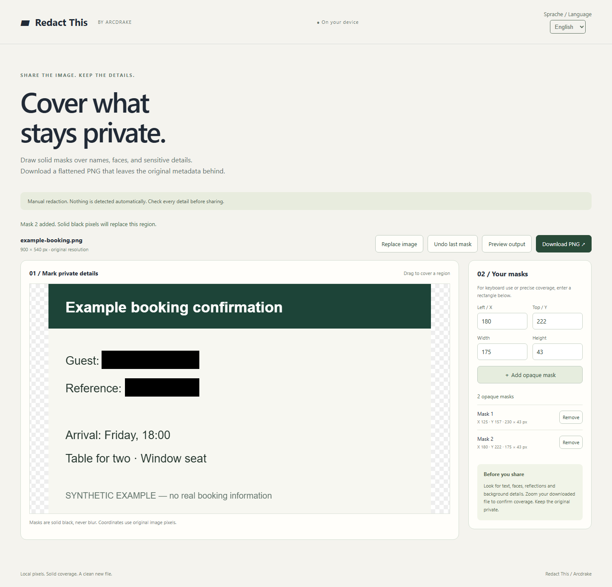

# Redact This

An Arcdrake browser tool for manual image redaction. Choose a still JPG, PNG or WebP, draw opaque black rectangles or enter pixel coordinates, and download a newly encoded PNG at the original resolution.



[Mobile preview](docs/screenshots/mobile.png). Screenshots use synthetic examples.

## Run locally

Install Node.js 24 or newer. No runtime dependencies or package install
are required. From the repository root:

```sh
node scripts/serve.mjs
```

Open http://127.0.0.1:43148. Serve modules over HTTP(S), not `file://`.

```sh
node --test tests/*.test.mjs
node scripts/package.mjs
```

The package command assembles only static files and licence/notices in
`artifacts/release/`, with a SHA-256 manifest; it does not deploy. No compilation or
network download occurs. For browser checks, follow the locked development setup below and use `npm run test:ci`, which manages its preview server.

## Limits and data

You choose every region; there is no automatic detection or completeness guarantee.
Always inspect the downloaded file before sharing. Covered pixels become opaque black;
original embedded metadata is not copied. The download filename is derived from the
original filename, so check and rename it if it contains identifying details.

No account, application upload, analytics or saved editing session. Limits: 40 MB,
40 million decoded pixels, 16,384 pixels per side and 200 masks. Animated PNG/WebP
and SVG are rejected; PDFs are unsupported. Header/decoding validation does not
promise exhaustive file-format compatibility. Refreshing clears the editing session.
The image decoder shares code with Shrink This Image; see the attribution in
[third-party notices](THIRD_PARTY_NOTICES.md).

Browser tests cover Chromium desktop and 390/320px layouts. Physical devices,
screen readers, Safari and Firefox have not been tested.

## Licence and feedback

[MIT](LICENSE), copyright 2026 Michael Eigner-Dietl. See
[third-party and asset notices](THIRD_PARTY_NOTICES.md). An
[Arcdrake](https://arcdrake.com/) product. Use synthetic examples when reporting
issues. Do not attach private data or unredacted personal images to public issues.
[Report a bug](https://github.com/ArcdrakeStudios/redact-this/issues).

## Source, support and development

[Source](https://github.com/ArcdrakeStudios/redact-this) · [Issues](https://github.com/ArcdrakeStudios/redact-this/issues) · [Contributing](CONTRIBUTING.md) · [Security](SECURITY.md)

Part of Arcdrake's tools collection. The planned shared home is `tools.arcdrake.com`;
production hosting is not live as part of this source release. Local use is available
above. Development checks use Node.js 24, Python 3 and locked Playwright tooling:

```sh
npm ci
npx playwright install chromium
npm test
npm run test:ci
npm run package:release
```

The CI wrapper starts and stops its own preview server. Runtime operation needs no
package installation. [Release procedure](docs/RELEASING.md).
